<div align="center">

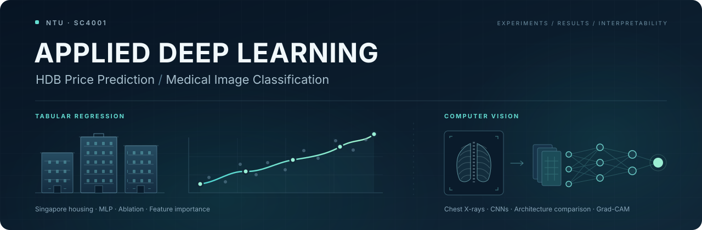

# Applied Deep Learning
### HDB Price Prediction · Medical Image Classification

**Two domains. One experimental workflow: build, compare, explain.**

<p>
  
  
  
  
</p>

<p>
  <a href="#overview">Overview</a> ·
  <a href="#part-a--hdb-resale-price-regression">HDB Regression</a> ·
  <a href="#part-b--chest-x-ray-classification">Chest X-rays</a> ·
  <a href="#getting-started">Getting Started</a> ·
  <a href="#reproducibility">Reproducibility</a>
</p>

**Yuan Zifeng** · Nanyang Technological University · SC4001

</div>

---

## Overview

A PyTorch portfolio exploring **structured-data regression** and **medical-image classification**, developed for **NTU SC4001: Neural Networks and Deep Learning**. The experiments combine categorical embeddings, hyperparameter search, controlled ablations, convolutional architectures, computational analysis, and model attribution.

The central question is how modelling choices affect both predictive performance and the evidence available to explain it. Every result below is linked to a saved CSV or JSON summary.

| | Part A: Singapore housing | Part B: Chest X-rays |
|---|---|---|
| **Task** | Predict HDB resale prices in SGD | Classify healthy vs. pneumonia |
| **Inputs** | 4 categorical + 6 continuous features | 64 × 64 grayscale images |
| **Models** | Embedding MLP, ablations, Wide-and-Deep | AlexNet-like, VGG-like, ResNet-like CNNs |
| **Evaluation** | Chronological holdout; RMSE and R² | Held-out test set; accuracy, sensitivity, specificity |
| **Interpretability** | Captum FeatureAblation | Grad-CAM on matched test images |
| **Result snapshot** | A1 test RMSE **SGD 98,729** | ResNet-like test accuracy **89.58%** |

### What this project demonstrates

- **Model selection:** validation-only searches followed by a fresh fit on combined training and validation data.
- **Experimental comparisons:** five-seed tabular ablations and a comparison of three compact CNN architectures.
- **Practical engineering:** resumable runs, dataset hashes, saved preprocessing, atomic checkpoints, and separate smoke-test outputs.
- **Interpretation:** feature-level attribution in SGD and visual inspection of CNN attention, with the limitations kept alongside the findings.

## Part A — HDB Resale Price Regression

### A1 · Embeddings and hyperparameter search

Each categorical feature has its own learned embedding. The embeddings are concatenated with standardized continuous variables, then passed through a **Linear → LayerNorm → ReLU → Linear** network. Training minimizes MSE on a standardized target; predictions are transformed back into SGD for evaluation.

<p align="center">
  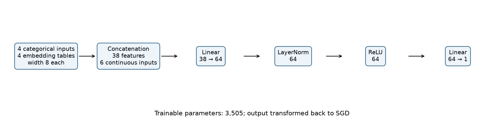
  <br />
  <sub>Original baseline architecture shown above: hidden width 64, embedding dimension 8. The search selects width 256 and dimension 4.</sub>
</p>

| Partition | Years | Purpose |
|---|---|---|
| Training | 2017–2020 | Fit preprocessing and model weights during search |
| Validation | 2021 | Select hyperparameters and epoch count |
| Test | 2022 | Evaluate the final model |
| Final fitting | 2017–2021 | Refit preprocessing and train a freshly initialized model |

The **25-trial Ray Tune grid** combines hidden widths `{16, 32, 64, 128, 256}` with embedding dimensions `{2, 4, 8, 12, 16}`. Adam uses learning rate `0.01` and batch size `512`; search runs allow up to 20 epochs with early-stopping patience 4.

| Selected configuration / metric | Value |
|---|---:|
| Hidden width | 256 |
| Embedding dimension | 4 |
| Selected epoch count | 6 |
| Best validation RMSE | SGD 58,743.82 |
| Final training RMSE | SGD 39,693.00 |
| Final test RMSE | **SGD 98,729.08** |
| Final test R² | **0.6637** |

Source: [A1 selection and final metrics](results/partA/a1_selected.json) · [All 25 search trials](results/partA/a1_search_results.csv).

<p align="center">
  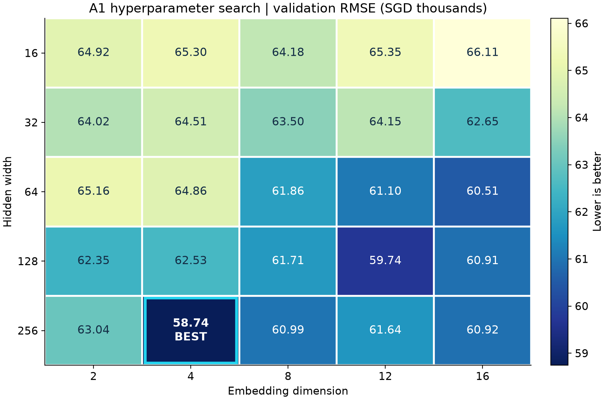
  <br />
  <sub>Validation RMSE across the full grid, reconstructed directly from the published trial results.</sub>
</p>

<p align="center">
  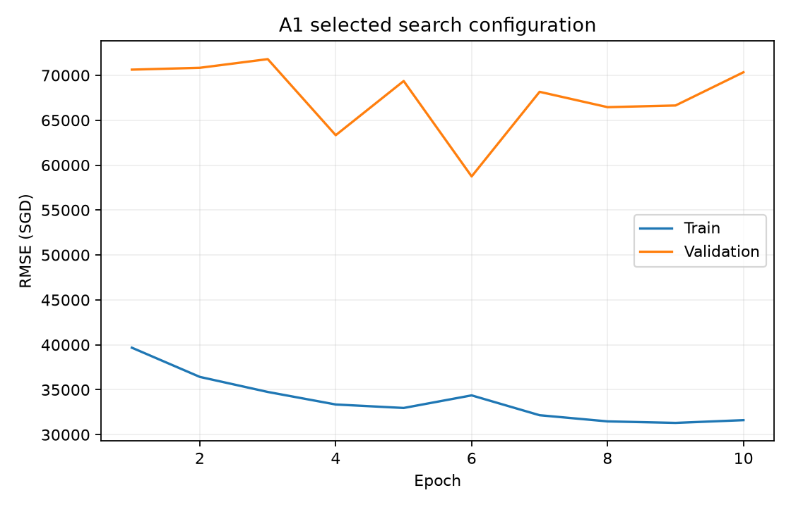
  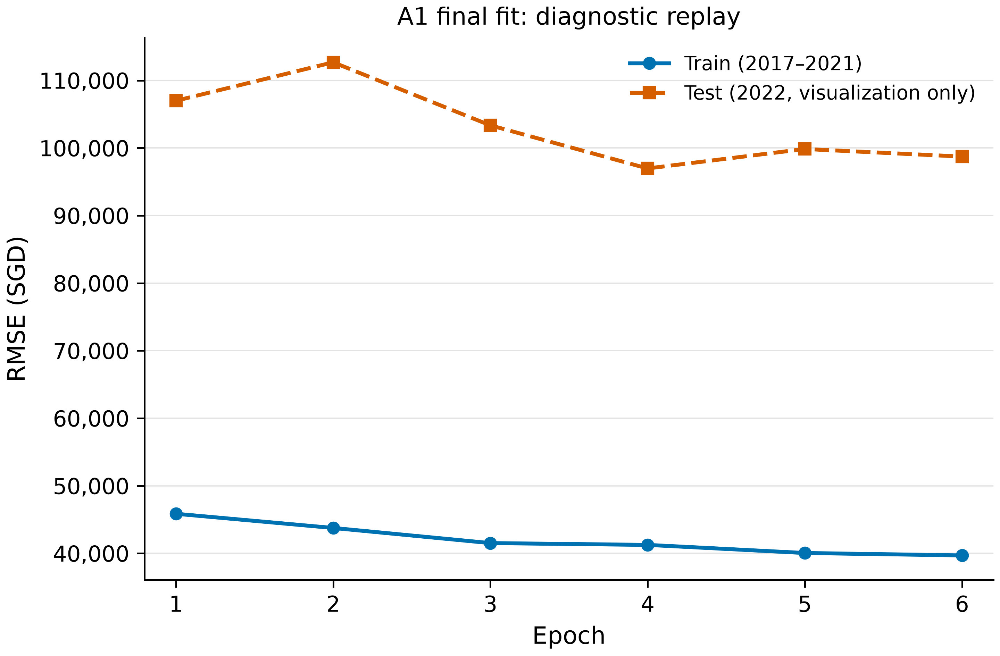
  <br />
  <sub>Left: selected search trial, with the lowest validation RMSE at epoch 6. Right: diagnostic replay of the final six-epoch fit.</sub>
</p>

The larger error on the 2022 test set shows that the validation result does not fully describe performance on a later year. This is consistent with temporal distribution shift, although these experiments do not isolate its contribution from other generalization effects. The right-hand figure is a **fixed-epoch diagnostic replay**: its test curve is used only for visualization and does not determine training updates, early stopping, or model selection.

### A2–A3 · Ablations and Wide-and-Deep

The selected configuration is compared across **five seeds: 42–46**. A2 removes categorical embeddings or replaces ReLU with Sigmoid. A3 adds a linear branch to the embedded feature vector:

```text
prediction = deep_branch(features) + λ × linear_branch(features)
```

| Model | Test RMSE, SGD ↓ | Test R² ↑ |
|---|---:|---:|
| **Embedding MLP / ReLU baseline** | **102,264 ± 2,698** | **0.6390 ± 0.0190** |
| Continuous features only | 109,295 ± 1,497 | 0.5879 ± 0.0112 |
| Embedding MLP / Sigmoid | 102,482 ± 5,630 | 0.6368 ± 0.0400 |
| Wide-and-Deep, λ = 2 | 105,943 ± 1,897 | 0.6127 ± 0.0139 |

Values are **mean ± sample standard deviation**, not confidence intervals. The A1 snapshot above is the single seed-42 run; the baseline here summarizes all five seeds.

Sources: [A2 summary](results/partA/a2_summary.csv) · [A3 summary](results/partA/a3_summary.csv) · [A3 λ search](results/partA/a3_search_results.csv).

<p align="center">
  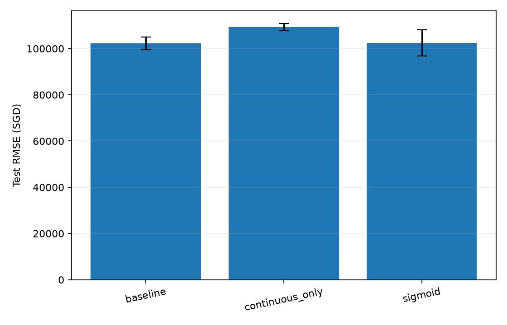
  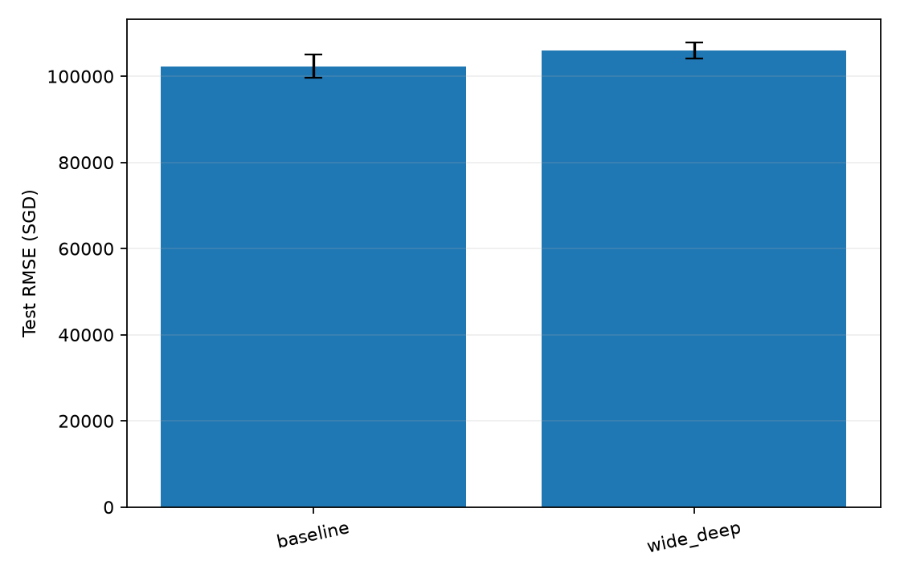
</p>

- **Categorical information helps:** removing embeddings increases mean test RMSE by approximately 6.9%.
- **Activation affects stability:** Sigmoid has a similar mean error but approximately twice the seed-to-seed RMSE standard deviation.
- **A better validation score does not guarantee a better test result:** λ = 2 achieves validation RMSE of SGD 57,930.36 but the Wide-and-Deep model has higher mean test error than the baseline. Its selected final fitting duration is 3 epochs, compared with 6 for the baseline, so the comparison includes an epoch-count difference.

### A4 · Which features influence predictions?

Captum **FeatureAblation** measures prediction changes when each original feature is replaced with a reference value. Categorical references are the most frequent categories in final fitting data; continuous references are their means. Global importance is the **mean absolute attribution over test examples**, in SGD.

<p align="center">
  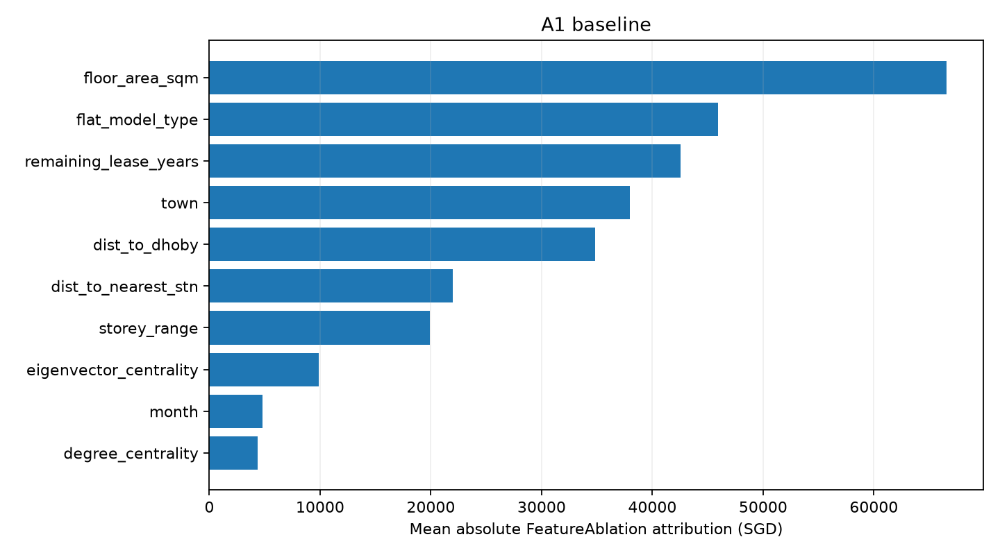
  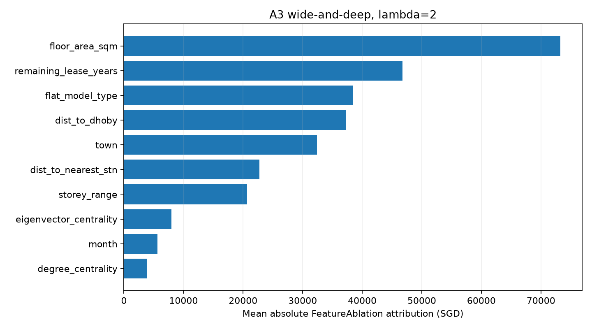
</p>

Both seed-42 models place **floor area**, **remaining lease years**, and **flat model/type** in their top three. These are model responses to specific reference values; their magnitudes should not be interpreted as causal effects or additive contributions to a property's price.

Sources: [Baseline attribution summary](results/partA/a4_baseline_feature_importance.csv) · [Wide-and-Deep attribution summary](results/partA/a4_wide_deep_feature_importance.csv).

## Part B — Chest X-ray Classification

### B1–B3 · Architecture, optimization, and cost

Three **custom, compact CNNs inspired by AlexNet, VGG, and ResNet** are trained from scratch. These are assignment-specific architectures, rather than pretrained implementations of the full reference networks.

Images are scaled from `uint8` to `[0, 1]` and normalized using the **original training split only**. Labels are `0 = healthy` and `1 = pneumonia`. Models output a raw logit and use **BCEWithLogitsLoss**, Adam, and validation-based early stopping.

| Experiment | Search / comparison | Selected final fit |
|---|---|---|
| **B1 · AlexNet-like** | Learning rates `10⁻⁵, 10⁻⁴, 10⁻³, 10⁻², 10⁻¹`; batch size 128 | LR 0.01 · batch 128 · 8 epochs |
| **B2 · VGG-like** | Batch sizes `16, 32, 64, 128, 256`; reuse B1 learning rate | LR 0.01 · batch 256 · 10 epochs |
| **B3 · ResNet-like** | Residual architecture; reuse B1 learning rate and B2 batch size | LR 0.01 · batch 256 · 10 epochs |

Within a trial, the saved checkpoint minimizes validation BCE loss. Hyperparameters are then selected by **validation classification error at that checkpoint**, with validation loss and epoch count as tiebreakers. Each final model is reinitialized and fitted on train + validation for its selected epoch count.

The supplied split contains **4,708 training**, **524 validation**, and **624 test** images. The test set comprises 390 pneumonia and 234 healthy examples.

| Model | Accuracy ↑ | Sensitivity ↑ | Specificity ↑ | Trainable parameters ↓ | FLOPs / image ↓ |
|---|---:|---:|---:|---:|---:|
| AlexNet-like / B1 | 85.42% | **99.74%** | 61.54% | 99,569 | 39.06M |
| VGG-like / B2 | 88.14% | 98.21% | 71.37% | **18,185** | **19.46M** |
| ResNet-like / B3 | **89.58%** | 97.44% | **76.50%** | 77,169 | 25.30M |

Sources: [Final model comparison](results/partB/b1_b3_comparison.csv) · [B1 search](results/partB/b1_search_results.csv) · [B2 search](results/partB/b2_search_results.csv) · [Layer-level complexity](results/partB/complexity_details.json).

**The tradeoff:** B1 misses only 1 pneumonia example but produces 90 false positives. B3 reduces false positives to 55 while missing 10 pneumonia examples, giving the highest accuracy and specificity among these runs. B2 uses the fewest parameters and FLOPs, with accuracy between B1 and B3. These are single-seed observations; they do not establish a statistically significant architecture ranking.

FLOPs are counted for **one `1 × 64 × 64` input**, using `2 FLOPs = 1 multiply–accumulate` for convolutional and linear layers. Bias additions, normalization, activations, pooling, residual additions, and sigmoid are excluded. These counts describe arithmetic cost, not measured inference latency.

<details>
<summary><strong>Explore the validation learning curves</strong></summary>

<p align="center">
  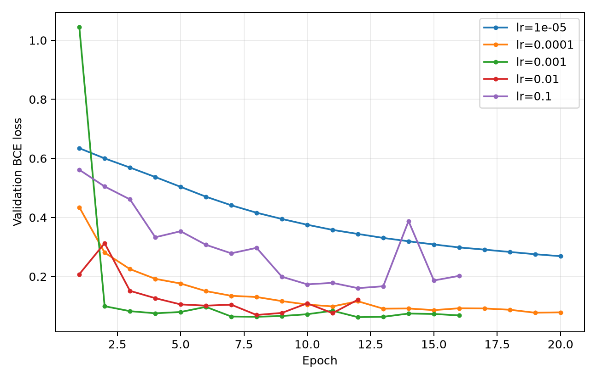
  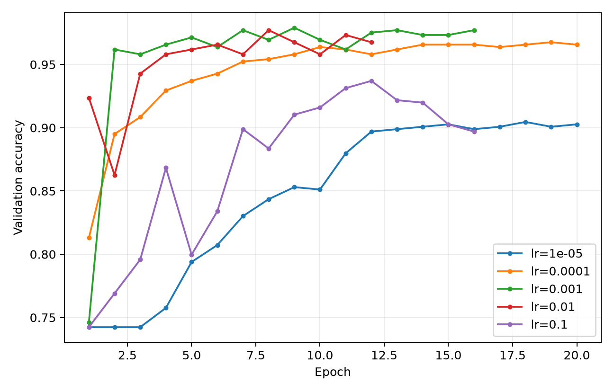
  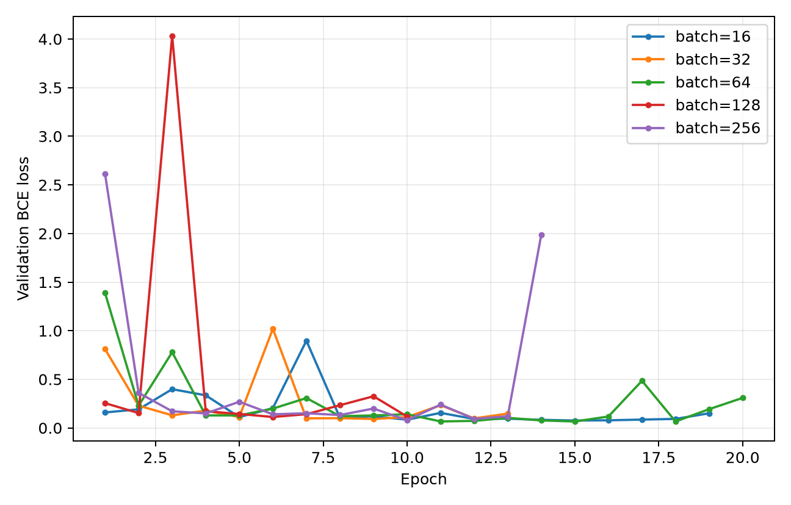
  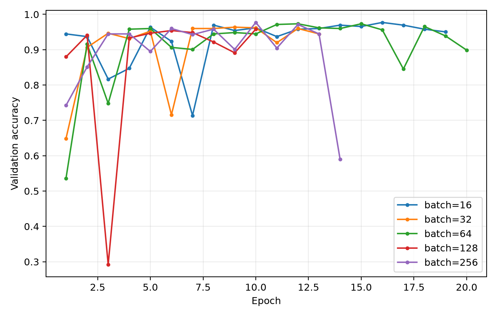
  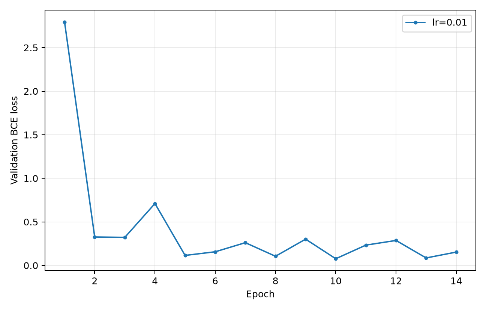
  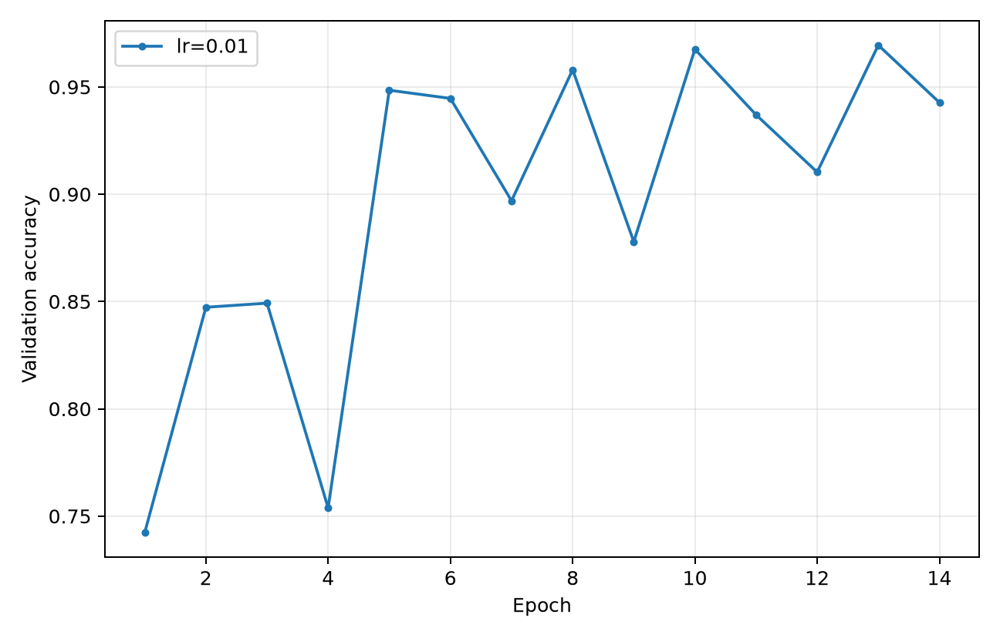
</p>

</details>

### B4 · Where do the CNNs attend?

Grad-CAM compares all three models on the **same five randomly sampled pneumonia test images**, without filtering by prediction correctness. The original test indices are `486, 279, 413, 53, 276` ([selection record](results/partB/b4_selected_indices.json)).

<p align="center">
  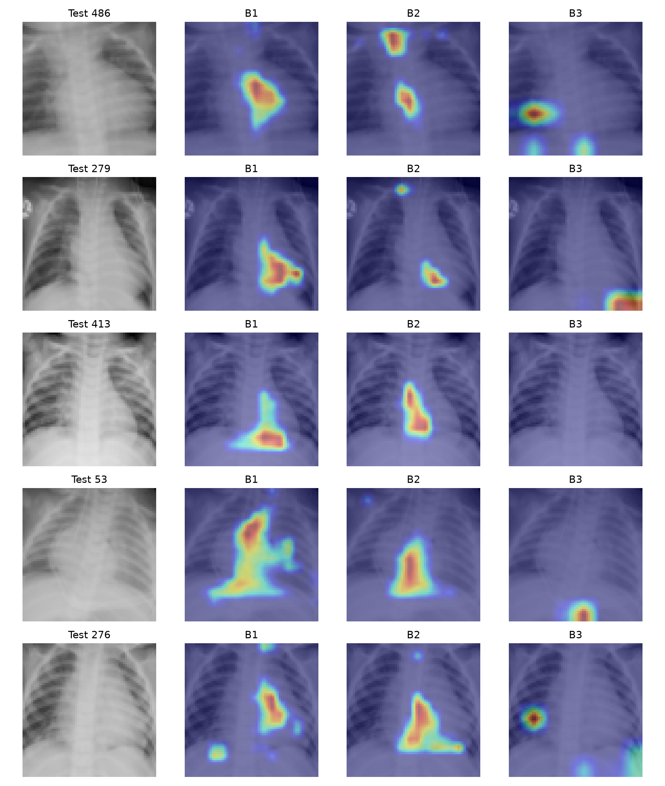
  <br />
  <sub>Left: original image. Remaining columns: AlexNet-like, VGG-like, and ResNet-like Grad-CAM.</sub>
</p>

The overlays show different spatial responses: several B1/B2 maps emphasize central or lower regions, while B3 sometimes highlights image edges and peripheral areas. Each heatmap is normalized separately, so color intensity cannot be compared as absolute attribution across images. Grad-CAM does not demonstrate lesion localization or clinical validity; the 64 × 64 resolution and single-seed training further limit interpretation.

## Getting Started

### 1 · Clone and create an environment

Run the commands from the repository root. The completed experiments used **Python 3.13**, **PyTorch 2.11.0**, and a CUDA 12.8 PyTorch build. The included [local package snapshot](requirements_local_lock.txt) records the original environment; [requirements.txt](requirements.txt) lists the project dependencies.

```bash
git clone https://github.com/Franky5278/Applied-Deep-Learning-for-HDB-Price-Prediction-Medical-Image-Classification-SC4001.git
cd Applied-Deep-Learning-for-HDB-Price-Prediction-Medical-Image-Classification-SC4001
python -m venv .venv
```

**Activate the environment:**

```powershell
# Windows PowerShell
.\.venv\Scripts\Activate.ps1
```

```bash
# macOS / Linux
source .venv/bin/activate
```

**Install dependencies:**

```bash
python -m pip install --upgrade pip
python -m pip install -r requirements.txt
```

For the CUDA 12.8 build recorded by the original experiments, install PyTorch first:

```bash
python -m pip install torch==2.11.0 --index-url https://download.pytorch.org/whl/cu128
python -m pip install -r requirements.txt
```

Use a PyTorch build appropriate to your hardware. The commands below explicitly select CPU or automatic device detection.

### 2 · Provide the datasets locally

Datasets are **not included**. Place your authorized copies in this layout:

```text
data/
├── hdb_price_prediction.csv
└── chestxray_binary_64.npz
```

The HDB CSV is a **prepared feature dataset**, rather than a raw resale-data download. It must contain:

| Field group | Required columns |
|---|---|
| Split / target | `year`, `resale_price` |
| Categorical | `month`, `town`, `flat_model_type`, `storey_range` |
| Continuous | `dist_to_nearest_stn`, `dist_to_dhoby`, `degree_centrality`, `eigenvector_centrality`, `remaining_lease_years`, `floor_area_sqm` |

The chest X-ray NPZ must provide train, validation, and test image/label arrays, for example `X_train`, `y_train`, `X_val`, `y_val`, `X_test`, `y_test`. Images must be `uint8` grayscale at 64 × 64; labels must be binary. See [the data loader](partB/common/data.py) for supported alternative array names and singleton channel formats.

The HDB task uses prepared Singapore resale-price data. The chest X-ray archive was provided for the course assignment. This repository does not include the upstream data preparation pipeline, datasets, or a downloadable replacement for the course archive; reproducing the saved results requires the same prepared inputs.

### 3 · Run the experiments

**Part A — full regression workflow on CPU:**

```bash
python partA/run_all.py --data-dir data --device cpu --workers 2 --threads 1
```

**Part B — full classification workflow:**

```bash
python partB/run_all.py --data-dir data --device auto --threads 2
```

To request a GPU explicitly, use `--device cuda:0`. To check the workflow on small subsets with at most two epochs per search trial:

```bash
python partA/run_all.py --data-dir data --device cpu --smoke-test --workers 2 --threads 1
python partB/run_all.py --data-dir data --device auto --smoke-test --threads 2
```

Full runs write to `partA/results/` and `partB/results/`; smoke runs use separate `results_smoke/` folders. These generated outputs are ignored by Git. The top-level `results/` contains the lightweight summaries published with this portfolio.

<details>
<summary><strong>Stages, resuming, and the optional diagnostic replay</strong></summary>

Both runners cache completed work and save checkpoints during training. Rerun the same command to resume or reuse an existing run; use `--output-dir` for a separate experiment and `--force` to recompute existing outputs.

```bash
# Run only the A1 search and final fit
python partA/run_all.py --data-dir data --device cpu --stage a1

# Run A2 after its A1 dependency has completed in the same output directory
python partA/run_all.py --data-dir data --device cpu --stage a2

# Run the Part B sequence through the B2 final fit
python partB/run_all.py --data-dir data --device auto --stage b2
```

Part A single-stage commands require completed predecessor stages in the same output directory. Part B runs its sequence through the requested stage, reusing completed work.

The optional `python partA/a1_diagnostic.py` replays the original six-epoch CPU A1 fit for the published train/test curve. It expects the exact original data, seed-42 configuration, and generated checkpoints in the default results directory, checks that the replay matches the saved model and optimizer, and refuses to overwrite its diagnostic outputs. It is a specialized audit script; the normal experiment runners do not require it.

</details>

## Repository Structure

```text
.
├── README.md                       # Portfolio, findings, and run instructions
├── requirements.txt                # Project dependencies
├── requirements_local_lock.txt     # Original local environment snapshot
├── partA/
│   ├── a1.py                       # Ray Tune search and final embedding MLP
│   ├── a1_diagnostic.py            # Exact diagnostic replay of the original fit
│   ├── a2.py                       # Five-seed feature / activation ablations
│   ├── a3.py                       # Wide-and-Deep λ search and comparison
│   ├── a4.py                       # Captum feature attribution
│   ├── run_all.py                  # Staged, resumable experiment entry point
│   └── common/                     # Data, models, training, and plotting
├── partB/
│   ├── run_all.py                  # B1–B4 search, final fitting, and Grad-CAM
│   └── common/                     # CNNs, data, runtime, training, and explanation
├── results/
│   ├── partA/                      # Published CSV / JSON regression summaries
│   └── partB/                      # Published search and classification summaries
└── assets/                         # Banner, architecture, curves, and attribution
```

## Reproducibility

| Component | Recorded protocol |
|---|---|
| Random seeds | A1 and A4: 42; A2 and A3: 42–46; B1–B4: 42 |
| Tabular preprocessing | Fit on training data for search; refit on train + validation for final fitting |
| Image preprocessing | Scale by 255; mean/std from the original training split, retained for final fitting |
| Model selection | Validation data selects configuration and fitting duration; test data is reserved for evaluation |
| Final fitting | Fresh model initialization; train + validation; fixed selected epoch count |
| Run records | Dataset SHA-256, runtime metadata, configurations, histories, and stage status |
| Recovery | Saved model / optimizer / RNG state; atomic checkpoint and JSON writes |
| Published evidence | Lightweight CSV/JSON summaries and figures included in this repository |

Seeds and saved state improve repeatability, but numerical results can vary with device, package versions, and backend behavior. Part A's five-seed summaries describe initialization variability; Part B reports one final fit per architecture. The saved metrics document completed experiments and are not a claim of performance on other datasets or later market periods.

## Academic Context & AI-Assisted Development

This is a cleaned portfolio version of coursework for **Nanyang Technological University, SC4001: Neural Networks and Deep Learning**. Course PDFs, assignment materials, full report PDFs, datasets, checkpoints, caches, and raw attribution arrays are excluded from the public repository.

**AI assistance disclosure:** OpenAI ChatGPT/Codex supported conceptual clarification, selected coding and debugging tasks, experiment management, reproducibility improvements, environment configuration, and English documentation review. The author reviewed the code, checked the experiment outputs, and remains responsible for the reported results and interpretations.

---

<p align="center">
  <strong>Yuan Zifeng</strong><br />
  Nanyang Technological University<br />
  <a href="https://github.com/Franky5278">GitHub · Franky5278</a>
</p>
